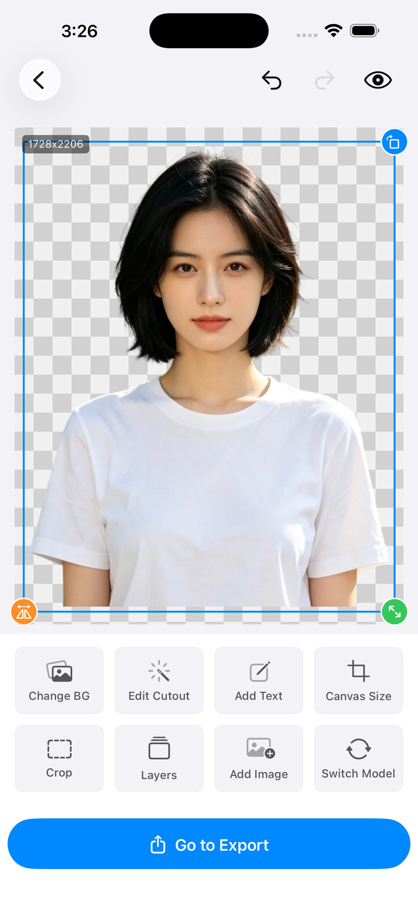

# Cutano - AI cutout

**Hair-level AI cutout, 100% on your iPhone.**

Your photos never leave your device — no cloud, no uploads, no accounts.

[Website](https://ppdd2012.github.io/cutano/) ·
[App Store](https://apps.apple.com/app/id6797933216) ·
[Product Hunt](https://www.producthunt.com/products/cutano-ai-cutout) ·
[Contact](mailto:ppdd2012@outlook.com)

---

## Overview

Cutano is a **100% on-device AI cutout app for iPhone**. A Core ML matting engine with
Metal GPU post-processing delivers hair-level precision — while your photos never leave
your device. Privacy enforced by the architecture, not by policy.

- **Zero data uploads** — the AI models run directly on your iPhone; there is no upload path for images anywhere in the app.
- **Works fully offline** — on a plane, in a secure office, with no connection, every feature works the same.
- **No account needed** — no sign-up, no analytics SDKs, no data beyond the photo library you explicitly grant.

## Features

| | |
|---|---|
| **Hair-level AI matting** | On-device Core ML segmentation + Metal GPU mask refinement. Live edge contraction & feathering, non-destructive erase/restore brushes with full undo. |
| **Swappable AI models** | Switch between portrait, general and edge-refined models and re-matte any object in place. Smart device tiering with automatic timeout fallback. |
| **Layer management** | A unified layer model of text and cutout objects — reorder, select and delete like a design tool. What you preview is exactly what you export. |
| **Iterative multi-cutout editing** | Keep cutting out on one canvas: add multiple subjects, each independently draggable, pinch-scalable, rotatable and flippable. Atomic undo never loses a step. |
| **AI shadow & reflection** | Real-time Metal-rendered contact shadows, blur and gradient-faded floor reflections ground every subject naturally. |
| **Batch processing** | Mat an entire album in one go with tiered scheduling and per-item retry. Export transparent PNG, layered PSD or high-res JPG. |
| **Product showcase** | Auto-cutout a product photo, recolor the background and export at platform-ready sizes. Pinch-zoom, drag to place, double-tap to reset. |
| **Crop & canvas size** | Free-form crop with grid guides and one-tap smart crop. Custom sizes plus original / 1:1 / 9:16 / 16:9 and presets like e-commerce hero, poster and Douyin backgrounds. |
| **Text & mixed image-text editing** | Add text with live color, opacity, size and font controls. Text lives as its own layer above or below any cutout object. |

## Privacy first

> **Privacy isn't a paid feature — it's the architecture.**
> Free users and subscribers enjoy the exact same data isolation.

1. **100% on-device inference** — image data never leaves your phone.
2. **No accounts · No cloud · No tracking** — nothing beyond the photo library you grant.
3. **Works offline** — every feature is identical with no connection.

## Under the hood

- **Multi-model Core ML engine** — BiRefNet-class on-device segmentation, multiple quality tiers.
- **Metal GPU acceleration** — mask refinement, shadows and reflections rendered on GPU.
- **Adaptive device tiering** — auto-matches your iPhone's power; graceful timeout fallback.
- **WYSIWYG export** — full-resolution layer replay; export matches preview pixel-for-pixel.
- **Transparent PNG / layered PSD** — alpha channel out of the box; PSD keeps editable layers.
- **StoreKit 2 subscriptions** — native Apple payments with Family Sharing and restore.

## Requirements

- iPhone running **iOS 17 or later**. The app automatically tiers work by device capability, so older iPhones stay smooth.

## Pricing

- **Free to download** — basic cutout works immediately.
- **Pro** — advanced models, layer compositing, AI shadows, layered PSD and original-resolution export (up to 8192px) unlock via subscription, billed entirely through Apple's native StoreKit 2. Plain cutout exports add no watermark and differ only by resolution (the free tier exports at a reduced resolution); some AI-generated or composed features, such as product showcase images, do carry a watermark until you subscribe.
- **Launch offer (limited time)** — lifetime access for **$0.99**, one week only. Final price follows your App Store region and local taxes, as shown at checkout. See the [website](https://ppdd2012.github.io/cutano/) for current offers.

## Links

- **Website:** https://ppdd2012.github.io/cutano/
- **App Store:** https://apps.apple.com/app/id6797933216
- **Product Hunt:** https://www.producthunt.com/products/cutano-ai-cutout
- **Privacy Policy:** [English](privacy_en.html) · [中文](privacy_cn.html)
- **Terms of Service:** [English](service_en.html) · [中文](service_cn.html)
- **Contact:** ppdd2012@outlook.com

## About this repository

This repository hosts the **static landing page** for Cutano, served via GitHub Pages at
**https://ppdd2012.github.io/cutano/**. The page is bilingual (English default, with a
中文 toggle) and contains no build step — `index.html` and the accompanying assets are
served as-is.

---

© 2026 Cutano · Your photos never leave your device.

